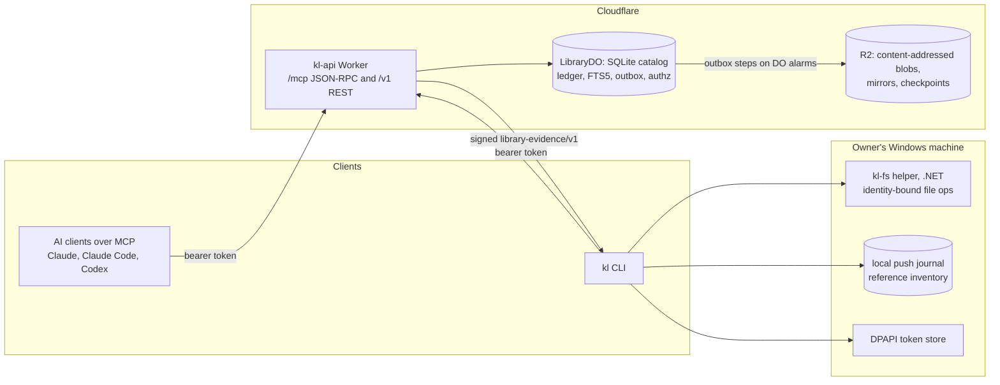

# Knowledge Library

[](https://github.com/sorry2befrank/knowledge-library/actions/workflows/ci.yml)
[](https://github.com/sorry2befrank/knowledge-library/actions/workflows/windows-conformance.yml)

A push-only, versioned archive for Markdown notes that AI agents can search and cite over MCP. It includes
a "librarian" that improves only through measured, reversible data changes, and a safety kernel that
decides when a note may leave a working folder.

It runs on Cloudflare Workers (a SQLite-backed Durable Object for the catalog, R2 for bytes), with a local
`kl` command-line client and a small native Windows helper for file operations that must not lose data.

**Status: not deployed publicly. Synthetic data only.** See [Status and limits](#status-and-limits).

## The problem

People who work with AI agents end up with folders full of Markdown: plans, handoff notes, decision logs,
status files. Two things go wrong.

1. **Agents read too much.** An agent working in a folder searches everything in it, including notes that
   have nothing to do with the current task. That costs context and can steer the agent with stale
   material.
2. **Cleaning up is risky.** Deleting or moving old notes loses history, breaks links that other files or
   scripts depend on, and is hard to undo.

This project is a design and a working core for handling both safely. It keeps every version of every note
in an archive that agents can query with exact citations. It takes a note out of a working folder only when
a fixed set of rules says nothing depends on it, verified copies exist in two independent places, and the
note can be put back byte for byte.

## Why it is interesting

- **Removal is gated by a pure kernel, not by a model.** Whether a file may leave is a deterministic
  function of approved inputs: policy, goal, pins, custody, git state, and a reference inventory of every
  link and path mention. Learned ranking can only choose among files the kernel already allows. Property
  tests check that the eligible set is sound, never grows when a protective fact is added, does not depend
  on input order, and is unchanged by any learned input (`test/kernel-properties.test.ts`).
- **One write path.** Every catalog change goes through `apply()`: policy gate, state check,
  compare-and-swap, undo record and a hash-chained ledger event, all in one transaction. External effects
  (R2 writes, deletes, indexing) go into a durable outbox and are idempotent. A lint fails the build if
  mutating SQL appears anywhere else.
- **File moves that keep a verified copy.** The Windows helper checks a file's identity (volume serial,
  file ID, link count, no reparse points) through an open handle, hashes through that handle, writes and
  re-verifies an independent copy, and only then deletes through the same handle. Fault-injection tests
  fail every filesystem call and journal write, before and after it runs, and check that a verified copy
  always survives.
- **Access control before ranking.** Search filters by the caller's collections, each version's own
  privacy class and the calling client's class before scoring, counting or building snippets. A denied note
  returns exactly the same response as a missing one.
- **Learning that has to earn its way in.** The librarian's behavior is data (playbooks). A candidate
  change must fix the failure it targets, beat the current champion on held-out labelled cases in the same
  replay, and pass canary checks before it is promoted.
- **Signed, checkable status.** The service publishes a signed `library-evidence/v1` envelope (Ed25519),
  with JSON Schemas and fixtures, so a separate dashboard can check what was archived, verified or moved
  without trusting the producer's word.

## Architecture



| Part | Code | What it does |
|---|---|---|
| Core library | `packages/core/src/` | IDs and hashing, citations, admission guard, catalog and `apply()`, outbox, ledger, search, MCP tool dispatch, token auth, policy acceptance, evidence producer, the focus kernel, reference inventory, the learning lane. Plain TypeScript that runs in Node and in workerd. |
| Contracts | `packages/contracts/`, `schemas/` | Versioned JSON Schemas (evidence, citations, admission results, persona manifest, cases) with valid and invalid fixtures. Validators are generated at build time. |
| API | `apps/api/src/` | The fetch handler for `/mcp` and `/v1/*`; Cloudflare adapters (Durable Object SQL driver, R2 store, outbox scheduler on Durable Object alarms, runtime limits); a closed bootstrap Worker. |
| Auth | `apps/auth/src/` | `klb_` bearer tokens: issue (setup mode only), introspection and self-revocation. |
| CLI | `cli/kl/src/` | `kl` commands: token storage and an MCP header helper, save, search, read, status, handoff notes, folder enrollment, push and sync. |
| Native helper | `cli/kl-fs/Program.cs` | Windows file operations through verified handles, and DPAPI-protected token blobs. |
| Session tools | `cli/sessions/` | Separate utilities for agent conversation logs on the same machine: a read-only size report, a tool that retires an old log to cold storage and refuses unsafe destinations, an exact restore script, and a grader for resume briefs. |
| Reference pack | `docs/reference/`, `vendor/`, `fixtures/reference/`, `policy/` | Formats and parsers from the owner's other tools that this system has to interoperate with. They are pinned by hash in `docs/reference/provenance.json` and checked by tests. |

The design document, [docs/DESIGN.md](docs/DESIGN.md), is a public summary of the full specification. Code
comments cite its section numbers.

## Safety rules and where they are enforced

| Rule | Enforced in | Tested in |
|---|---|---|
| The admission guard runs before any durable write; credentials and student records are rejected, and the matched text is never echoed | `packages/core/src/admission/guard.ts`, `admission/reference-policy.ts` | `test/s1b-security.test.ts`, `test/reference-admission.test.ts`, `test/reference-policy.test.ts` |
| Catalog changes happen only through `apply()` | `packages/core/src/catalog/apply.ts`; `scripts/lint-mutating-sql.ts` fails the build otherwise | `test/catalog.test.ts`, `test/takeover-integrity-review.test.ts` |
| External effects are durable, idempotent outbox steps | `packages/core/src/catalog/outbox.ts`, `apps/api/src/cloudflare/outbox-scheduler.ts` | `test/outbox.test.ts`, `test/cloudflare-outbox-scheduler.test.ts` |
| Access control comes before ranking; denied looks like missing | `packages/core/src/catalog/acl.ts`, `catalog/search.ts`, `apps/api/src/handler.ts` | `test/acl.test.ts`, `test/class-ceiling-team.test.ts` |
| A save mixing privacy classes is held at every source class | `packages/core/src/catalog/privacy.ts` | `test/s1c-security.test.ts` |
| The eligibility kernel is pure; learning only narrows it | `packages/core/src/focus/eligibility.ts`, `focus/reference-closure.ts`, `focus/recheck.ts` | `test/kernel-properties.test.ts`, `test/eligibility.test.ts`, `test/reference-closure.test.ts` |
| A move is bound to a verified file identity and always keeps a verified copy | `packages/core/src/focus/safe-move-model.ts`, `cli/kl-fs/Program.cs` | `test/safe-move-model.test.ts`; `test/fs-windows-*.test.ts` in Windows CI |
| A policy takes effect only with a valid signed acceptance at a current epoch | `packages/core/src/policy/acceptance.ts` | `test/policy.test.ts` |
| Evidence is signed and schema-validated | `packages/core/src/evidence/producer.ts`, `packages/contracts/src/semantics.ts` | `test/evidence.test.ts`, `test/contracts.test.ts` |
| Note text returned to models is wrapped and escaped as untrusted data | `packages/core/src/primitives/untrusted.ts`, `tools/call.ts` | `test/api.test.ts`, `test/s1b-security.test.ts` |
| No credential shapes anywhere in the tree, and no workstation paths outside `docs/` and this README (which documents the default state directory) | `scripts/scan-secrets.ts` (a CI step) | `test/s1c-hygiene.test.ts`, which plants synthetic tokens in a temporary tree |
| Only allowed files live under `persona/` | `scripts/lint-persona.ts` (a CI step) | — |

## Running it

Requirements: Node 22.18 or newer (CI uses Node 22) and Git on `PATH` (the secret scan uses `git grep`).
The Windows native suite also needs the .NET 8 SDK.

```sh
npm ci
npm run check        # typecheck, citation lint, SQL lint, persona lint, secret scan, full test suite
```

Individual steps:

```sh
npm run typecheck
npm test                         # vitest; add -- --maxWorkers=1 on a busy machine
npm run fixtures                 # regenerate the synthetic corpus from its seed
npm run bench                    # local catalog benchmark (the SQL engine only, not Cloudflare)
npm run cloud:types -- --check   # Wrangler type generation matches the committed types
npm run cloud:dry-run            # wrangler deploy --dry-run; no credentials, nothing uploaded
```

The full suite takes roughly 10 to 20 minutes on a laptop. Several workerd tests have fixed time budgets (some
deliberately, because the runtime enforces response deadlines), so on a slow or heavily loaded machine they
can time out under full parallelism; `npm test -- --maxWorkers=1` avoids most of that. On Windows without
the built `kl-fs` helper, the native suites fail by design rather than skip, so that a missing helper is
never mistaken for a pass.

`npm run build:spec` derives the specification identity from the bytes of `docs/DESIGN.md`; tests and the
typecheck run it automatically. Both Wrangler configs carry a zero account ID and local-only names. They
are templates and cannot deploy anything. `kl` keeps its local state outside the checkout, in the directory
named by `KL_STATE_DIR`. If that variable is unset, the archive command falls back to `D:\.knowledge-library\state`, the
author's Windows layout, so set `KL_STATE_DIR` on any other machine.

## How I know a change is safe to ship

An agent asks the library a question and gets back notes with citations. The answer-accuracy eval checks
that those are the right notes, the current versions, and citations that verify, and it fails the build
when any of that gets worse.

```bash
npm run eval   # the run itself takes well under a second; writes eval/RESULTS.md and eval/results.json
```

It builds an archive of 28 invented notes (a bakery's oven manuals, a town's bus timetables and so on)
through the library's normal save path, then asks 43 questions through the same tool calls an MCP client
makes (`library_search`, `library_read`, and two cases over JSON-RPC over HTTP). Nothing in search, citation
or read is mocked. Every citation returned is read back and compared byte for byte with the text that was
saved. Measured on baseline v0 ([full table](eval/RESULTS.md)):

| Measure | Result |
|---|---|
| Cases passed | 32/43 |
| Right note first (hit@1), questions with one expected note | 17/24 |
| Right note in the top 5 (hit@5) | 23/24 |
| Returned citations that verify against the saved text | 171/171 |
| Bad citations refused (wrong hash, missing version, wrong line-span hash, note the reader may not see) | 4/4 |
| No hits when the archive has no answer | 2/5 |
| Notes returned to a reader who may not see them | 0 |

`test/eval-answer-accuracy.test.ts` runs the eval inside `npm test`, so CI runs it on every push and pull
request. It fails if any metric falls below the floors in `eval/thresholds.json` (set from the measured
run), if a case that passed now fails, or if the committed results table no longer matches a fresh run.
The 11 failing cases are labelled known gaps with the code that causes each one: no abstention (search
falls back to matching any word), supersession that is recorded but never applied to ranking, no newer-version
signal on an old citation, unequal BM25 scores across per-class indexes, and a planted note that copies
the question's title and ranks first. If one of them starts passing, the test fails until the label is
removed and the floor raised, so a gain cannot be lost later.

To check that the gate works, I broke three things on purpose and ran it. Skipping the citation hash check
let a tampered citation through (bad citations refused 4/4 to 3/4). Reversing the ranking order dropped
hit@1 from 17/24 to 5/24. Returning old versions in search made the library-hours question cite version 1
of 3. Each time the test failed; each change was then reverted.

**Scope.** There is no language model in this library: retrieval is keyword search (BM25) plus a fixed
re-rank. So this is a retrieval-and-citation eval of what an agent receives, not a measure of answers a
model writes from those notes. The corpus is small and synthetic, the questions were written by the same
person who wrote the notes, and the numbers say nothing about real notes, other languages or larger
archives. It does not test the removal kernel, the Windows helper or the deployed Worker; other suites do.

## How it is tested

- **Answer accuracy.** `npm run eval` and its gate test; see the section above.
- **Vitest** runs unit, integration and property-based tests (fast-check), including suites that run the
  real Worker code in workerd through Miniflare.
- **Synthetic data only.** `fixtures/gen.ts` generates the corpus, principals and planted hazards (fake
  credentials, prompt-injection text, stand-in client names) from a fixed seed. CI checks that two
  regenerations are byte-identical.
- **Fault injection.** The move model and the journals are tested by failing every filesystem call and
  every journal append, before and after it runs.
- **Security regression tests.** Each security fix comes with tests that fail against the vulnerable code
  and pass against the fix.
- **Windows conformance.** A separate workflow builds `kl-fs` with .NET 8 on `windows-latest` and runs the
  native filesystem and DPAPI suites. A gate script checks the results against a manifest of required cases
  and records the helper's SHA-256.

The secret detectors are tested with credential-shaped strings. Those test values are assembled from
pieces at runtime, so no complete credential-shaped string is stored in the repository and the repository's
own secret scan passes.

## CI

Two GitHub Actions workflows run on pull requests, on pushes to `main` and on manual dispatch (`ci` also
runs on pushes to other branches):

- `ci` (ubuntu-latest): `npm ci`, typecheck, Wrangler type check and dry run, the SQL, citation and persona
  lints, the full test suite (including the answer-accuracy gate, whose table is added to the job summary),
  a fixture determinism check, and the secret and workstation-path scan. A
  staging deploy job exists but is disabled (`if: false`). CI holds no Cloudflare credentials.
- `windows-conformance` (windows-latest): builds the native helper and runs the Windows-only suites.

## Status and limits

- **Not deployed publicly, and no real notes are stored by anything in this repository.** Every test and
  fixture uses synthetic data.
- **Built:** the catalog and `apply()` write path, outbox, ledger, admission guard, privacy classes and
  ACL-filtered FTS5 search; five of the eight designed MCP tools (`library_save`, `library_search`,
  `library_read`, `library_feedback`, `library_status`); bearer-token auth; signed policy acceptance; the
  signed evidence producer and its schemas; the eligibility kernel with reference closure and recheck; the
  reference inventory; the safe-move model and the Windows helper; the learning lane's replay and grader;
  and Cloudflare adapters with a bounded Durable Object runtime and a closed bootstrap Worker.
- **Designed but not built:** OAuth sign-in and the passkey approval page (`/approve` returns 501 today);
  `library_context`, `library_review` and `library_focus`; veil files; the end-to-end focus apply and
  restore commands; scheduled weekly workflows; and the backup integration. Their design is in
  `docs/DESIGN.md`.
- **Windows-first client.** The `kl` file operations, token store and native helper target Windows. The
  core, the API and most tests are platform-neutral.
- **Integration target.** Some code and the reference pack refer to "Orrery", the owner's separate, private
  orchestration system that would consume the evidence feed. Its side of the integration is not in this
  repository, and nothing here depends on it at runtime.
- **History not included.** This public copy is a single snapshot. Internal session work orders, build
  turnovers and review records were removed. Some code comments still cite those work orders by name (for
  example `docs/sessions/S1c.md`) or refer to "the turnover".

## How it was built

The code was written by AI coding agents (Claude Code and Codex) under the owner's direction and review,
with tests as the gate. Work landed through pull requests (39 in the private development repository, 34
merged). The Linux CI workflow ran on every merged one; the Windows conformance workflow ran on 20 of
them (PR 11 and PRs 16 to 34). Findings from independent review passes were fixed with regression tests. Frank Epps Jr. set the requirements and rulings, reviewed the work
and decided what merged. The development history stays private; this repository is a clean snapshot.

## License

MIT. See [LICENSE](LICENSE).
