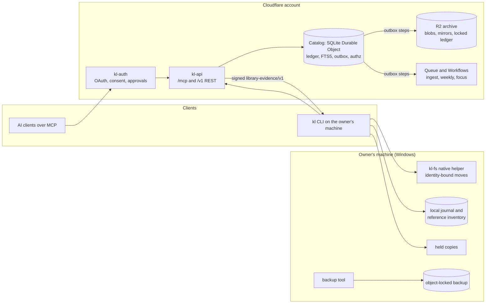

# Knowledge Library design (public summary of r0.6)

**Status: FINAL r0.6. This file is a public summary written for outside readers.** The full working
specification contains owner-specific rulings, machine layout and operating decisions, and is not part of
this repository. Section numbers match the full specification, because comments in the code cite them
(`DESIGN §6.4` and so on). Sections that are only about the owner's private setup are left out; their
numbers are skipped, not reused.

The build tooling hashes this file (`scripts/build-spec.ts`) and the evidence producer reports that hash as
its specification identity. Editing this file changes that identity, which is intended.

This document describes the **target design**. Much of it is implemented and tested with synthetic data
(see the README's status section). Production deployment, real-data upload and real removal of files are
not enabled.

---

## 1. Summary

A private, push-only cloud archive for Markdown notes that AI clients (Claude, Claude Code, Codex and other
MCP clients) can search and cite. It never reads a disk on its own: it stores only what a save call or the
`kl` command sends it. Every save that changes the bytes becomes a numbered version, and answers cite exact
versions. Secrets and student records are refused at admission; client material is refused until a decision
is recorded for that client.

A **librarian** works on the archive. It tags, links, flags duplicates and builds cited context packs. Its
mistakes become test cases, and it improves only by changing data (a "playbook"), never code or model
weights. A changed playbook must fix the mistake, beat the current champion on labelled cases it never
trained on, and break no must-pass case before it is promoted.

A **weekly focus cycle** keeps working folders lean. Notes that the current task does not need may leave a
folder, but only when fixed rules allow it, the archive and an independent backup both hold verified
copies, and a restore can put them back without overwriting anything. Learning can rank candidates; it can
never widen what is allowed to leave.

---

## 2. Architecture

### 2.1 Principles (a higher one wins any conflict)

1. **Custody before removal.** A note leaves a working folder only when its exact bytes have been read back
   from the archive and hash-verified, found in a verified backup snapshot, and held as a verified
   independent local copy. A hard link is another name for the same bytes, never a copy.
2. **Eligibility is the owner's; relevance is learned.** The kernel `E` is a pure function of accepted,
   receipted inputs (policy, approved goal, snapshot, pins, custody, history, git state, reference
   inventory, reservations). No learned value is an input. Proposals satisfy `R ⊆ E`, and the executor
   recomputes `E` at apply time.
3. **Authority is a receipt.** A consequential action needs a transaction-bound approval receipt that
   covers the exact action and evidence. Environment checks are accident guards, not attestation.
4. **One write path for the catalog; an outbox for everything else.** `apply()` runs the policy gate, a
   state check, compare-and-swap on the version and the undo record in one transaction. Every external
   effect (R2 writes and deletes, mirrors, indexing, evidence publication) goes into a durable outbox with
   an operation ID, and each step is idempotent. A lint rejects mutating SQL anywhere else.
5. **Learning is data, measured, on its own lane.** It changes no code and no weights, and it is mostly
   deterministic replay.
6. **Untrusted text never authorizes anything.** Text that arrived over MCP is data. Authorization rests on
   scoped tools and credentials, never on a model obeying delimiters.
7. **Explicit ownership between systems.** The Library owns its runtime, custody, moves and learned
   champions. A consuming dashboard (here, the owner's separate orchestration system, called "Orrery" in
   the code) only reads a signed evidence feed and may propose goals. Neither side executes the other's
   instructions.
8. **Quiet unless new; honest when unknown.** Unknown cost, coverage or freshness is reported as unknown.

### 2.2 Diagram

### 2.3 Components

| Component | Responsibility |
|---|---|
| `kl-auth` | OAuth authorization server with exact redirect URIs, PKCE, a consent page with a CSRF token, short-lived access tokens and rotating refresh tokens. It stamps a `client_class` on every grant and serves `/approve`, the approval surface. |
| `kl-api` | Stateless MCP handler on `/mcp` and REST on `/v1/*` for `kl`. Checks principal status on every request. Every path authorizes through a currently accessible note or version, never through possession of a hash. |
| Catalog | One SQLite store: ledger, catalog, FTS5, focus, learning, approvals, authz journal and outbox, behind a `Catalog` port so the store choice does not leak. |
| R2 archive | Bytes and durable exports. `blobs/` is written only by the shared `BlobWriter`, after the admission guard and a digest check. Ledger and authz exports are content-free. |
| Queue and Workflows | Verify, parse and index incoming objects; run the weekly librarian and focus workflows. |
| `kl` CLI | The only component that touches the local disk. All filesystem effects go through an `Fs` port with a Windows adapter and an in-memory adapter. |
| `kl-fs` helper | A small .NET executable built from this repo: exclusive-open hashing, copy, delete through the verified handle, non-replacing rename and identity checks. |

### 2.4 Catalog store

The working choice is one SQLite-backed Durable Object (`LibraryDO`), because one object gives a single
writer for the hash chain, compare-and-swap and outbox ordering. `scripts/bench-store.ts` measures write
latency, FTS p95 and storage growth on generated corpora; it measures the SQL engine locally, not
Cloudflare's runtime. Note bytes live in R2; text stored for FTS is chunked well under the row limit.

### 2.6 Placement rule

All local runtime state lives in one dot-directory outside the repository checkout. Nothing the tool writes
locally lives inside the checkout.

### 2.7 Policy acceptance

Policy files in the repo are **proposals**. A policy takes effect only when a valid receipt approves its
exact bundle hash and the service signs an acceptance record `{policyHash, epoch, receiptId}`. `kl`
verifies acceptance records with a pinned public key. Each acceptance raises the epoch, and an older epoch
is refused (anti-rollback). A missing or unaccepted policy fails closed: everything becomes a proposal and
nothing is removed.

---

## 3. Push, admission, identity and versions

### 3.1 Identity

| Thing | Identity |
|---|---|
| Blob | SHA-256 of the exact bytes; written once, deduplicated, reference-counted. |
| Note | `noteId`: 10-character Crockford base32, minted on first sight of `(collection, path)`, never derived from a path. |
| Version | `noteId@ver`, append-only; a new version only when the bytes differ. A save whose parent is not the current version is stored as a sibling and the note is marked `conflict`. |
| Folder | Minted per device, volume serial, root file ID and folder. Learning keys on it, never on a path. |
| Citation | `kl:<noteId>@<ver>#L<a>-L<b>~<sha8>`. The span hash makes a citation verify itself. A missing version returns `version-not-found`, never the latest. |

The library never writes IDs into the user's files.

### 3.2 Collections, privacy classes, deny rules

A collection has a privacy class (`team`, an owner-private class, `client:<id>`, and always-denied classes
for credentials and student records). Registering a root requires a privacy census receipt and an explicit
class. Deny rules are enforced by both `kl` and the server: denied directory segments, denied file names,
and content detectors for credential shapes (Stripe-, JWT-, Anthropic-, Slack-, Google- and Meta-style
keys, private key blocks, `*_API_KEY=` assignments and the library's own `klb_` bearer tokens),
student-record signatures and a client-name detector. The real client-name list is a private overlay
installed in production config and never enters the repository. A refused file is reported
(`held-local:<rule>`), never skipped silently.

### 3.3 Admission guard

The guard runs before any durable write: in `kl` before upload, and in the Worker before `BlobWriter`. MCP
saves, batch upload, single upload and multipart ingestion all get identical outcomes.

| Guard result | Outcome |
|---|---|
| Secret or credential | Rejected; nothing stored. A `klb_` token found this way is revoked. |
| Student record | Rejected; nothing stored. |
| Client match without a recorded decision | Rejected; nothing stored. |
| Derived-content warning | Stored at the narrowest known class in the saver's private inbox, held for review. |
| Clean | Admitted. |

Responses carry a rule code and a request ID, never the matched text. A save that follows a read of a
narrower-class note through the same grant, without declared lineage, stays at the narrowest class read.

### 3.4–3.5 Saves and pushes

`library_save` takes up to 1 MiB of UTF-8 text and returns a citation. `kl push <folder>` scans one folder,
sends only paths and hashes for a diff, uploads what is missing, and commits verified items in one catalog
transaction. Every step is journaled locally, so a re-run resends only what is missing. A partial push is
reported as partial.

### 3.7 Absence, withdrawal, purge

A local deletion never deletes in the archive. Withdraw hides a note immediately. Purge is the only
destruction path. It runs through `apply()` and the outbox, and it refuses while another note shares the
blob or the note is focus-held.

### 3.8 Operations, outbox and recovery

Every multi-step action has a durable `operationId`. The catalog transaction records the intended external
steps in `outbox(opId, step, target, idempotencyKey, state, attempts, lastError, completedAt)`, and a
dispatcher (a Durable Object alarm) runs pending steps. Steps are idempotent: put-if-absent with a digest
check, delete-tolerant-of-absent, mirror writes with `onlyIf`, keyed index messages.

Blob lifetime is fenced in the catalog (`live`, `pending`, `gc-pending`, `deleting`, `deleted`), so a blob
referenced by an open push is never an orphan, and a delete re-checks its state in the same transaction. A
version is readable only after custody is verified by a post-commit HEAD. Test fixtures crash the system
after every external step and check that it converges.

**Authorization continuity.** Recovering content must never recover old permissions. An authz journal
records grants, revocations, withdrawals, purges and policy acceptances. A narrowing event is checkpointed
to locked storage before it is acknowledged. A rebuilt catalog that cannot reach the latest checkpoint
serves no reads.

---

## 4. Catalog, search and MCP tools

### 4.1 Catalog tables

A hash-chained `events` ledger whose payloads hold only ids, enums and hashes (text lives in a purgeable
`values` table); `notes`, `versions`, `blob_refs`, `aliases`, `folders`, `collections`, `principals`,
`tokens`, `consents`; organization tables (`tags`, `edges`); focus tables (goals, plans, items, veils,
pauses, reservations); learning tables (signals, cases, playbooks, candidates, champions, ladders); and an
FTS5 index over line-spanned chunks.

### 4.2 Search: keyword first, learned on top

1. **Access control first.** The SQL `WHERE` admits a row only if the principal's classes and collections,
   the version's own privacy class and the token's client class all allow it. This applies before ranking,
   counts, snippets and context packs. A denied note looks exactly like a missing one.
2. Query expansion from the retrieval champion playbook. Learning is query-side, so replay needs no
   reindex.
3. FTS5 bm25, then a linear re-rank with playbook weights.
4. Results carry generated reason codes, status, supersession and freshness fields.

Semantic search is a challenger playbook field, to be built only if measured misses justify it.

### 4.3 Freshness

The archive is push-only, so it cannot see the live folder. When live freshness is unknown, responses say
`freshness: last-known as of <last push>`. Conflicts and unconfirmed supersessions are shown, never
resolved silently.

### 4.5 MCP tools (8)

`library_search`, `library_read`, `library_context`, `library_save`, `library_feedback`, `library_review`,
`library_focus`, `library_status`. Five are implemented (`library_save`, `library_search`, `library_read`,
`library_feedback`, `library_status`); `library_context`, `library_review` and `library_focus` are designed
but not built. Every note-derived string is returned inside a nonce-tagged
`<untrusted-note-…>` wrapper; this is hygiene, not a security boundary. Outputs are size-bounded and carry
the ledger generation.

**Through MCP a principal may narrow, never widen.** Exclude, hold, veto, pin, pause and restore-request are
allowed. Approving a removal, changing policy or access, promoting a playbook, withdrawing or purging all
need an approval receipt.

---

## 5. The librarian

On ingest the librarian does deterministic work: exact duplicates by hash, near duplicates by MinHash
(5-word shingles, 64 permutations), supersession hints, decision-to-implementation hints and tag
suggestions. Everything is a proposal with an evidence citation unless that capability's trust rung allows
applying it.

A weekly workflow runs a bounded librarian sweep, adjudicates trust-ladder windows, runs rehearsal, writes
per-principal status, and accounts for every opted-in project (assessed, partial, skipped or pending, with a
reason). The librarian works fully with no model calls. Optional model use is bounded per lane, and its
output is parsed into an allow-listed schema.

---

## 6. The weekly focus cycle

### 6.1–6.2 Goal and folder policy

The owner sets a goal for a folder (`kl focus "<folder>" "<task>"`); goals from other clients are proposals.
A folder policy sets caps (per run, per week and per 28 days, measured against a frozen baseline count),
grace periods after edits and restores, git mode, link-guard strictness and the approval floor.

### 6.3 Reference inventory

A local inventory reads every note, every code and config file and every agent-instruction file under the
configured roots. It extracts links, explicit path mentions, name mentions and code references. Each
generation records its roots, exclusions, read errors and completeness. **Incomplete coverage always
protects:** a read error or skipped file makes every candidate `coverage-incomplete`.

### 6.4 The kernel: eligibility set E

`E = eligible(snapshot, goalRev, policy, pins, custody, history, gitState, refGeneration, reservations,
integrationState)`, implemented in `packages/core/src/focus/eligibility.ts`. A file is in `E` only if every
rule holds:

1. It is a file of an allowed type.
2. It is not hard-pinned (instruction files, status and handoff files, persona files, open or bookmarked
   notes, goal pins, owner designations, and files cited by pending review records).
3. It was not edited or newly arrived within the grace period.
4. It was not restored recently.
5. Git: it is untracked in the innermost repository, or the opt-in sparse mode applies. Unreadable git state
   makes it ineligible as `git-unknown`.
6. The archive holds a verified version whose hash equals the current bytes.
7. No protective reference from a kept note. A resolved link or explicit path mention blocks, an ambiguous
   link blocks, and a name-only mention requires an explicit tick. The candidate set is iterated to a fixed
   point, so a mutually linked group of off-task notes can leave together.
8. It is inside the chosen folder, on the recorded volume, and not in a denied segment.
9. No file in the consuming system's watched set mentions it by path token.
10. No dependency, instruction-file mention or active reservation.
11. Identity is safe: one hard link, no reparse point in the path, a supported local volume.

After scoring picks `P`, rules 7, 9 and 10 are re-run against everything not in `P` until the set is
stable, at plan time and again at apply time (`focus/reference-closure.ts`, `focus/recheck.ts`). An empty
`E` is a truthful no-op that reports the blocking reasons.

### 6.5 Proposal P ⊆ E

The champion focus playbook scores each note on frozen features (bm25 of the goal, link distance, days
since edit and since last read, past restores, status, perishability). `P` is the lowest-relevance notes
below a threshold, capped by the remaining allowances, then closed as above. **Learning never widens
authority:** for fixed accepted inputs, changing a playbook cannot change `E`.

### 6.6 Veil mode

Before any removal is enabled, `kl veil` writes one generated `.ignore` file listing off-task notes, so
ripgrep-based content search (including Claude Code's Grep) skips them. Nothing moves. It writes or deletes
the file only when no file exists or the existing bytes equal what it last wrote.

### 6.7 Approval rungs

F0 item review, F1 batch review, F2 standing rules, F3 scheduled. A pilot starts at F0 with one item;
measured evidence and a new receipt are required to move up. Pause is always available without a receipt;
resume needs one. Ordinary agent or CI invocations of review and admin commands only create a request.

### 6.8 Push, verify, remove: `safeMove`

`safeMove` is the only primitive that removes a file from a working folder. Any implementation must:

1. act only on the file identity (volume serial, file ID, SHA-256) its caller verified and journaled;
2. refuse reparse points in the path, a replaced parent directory, more than one hard link and unsupported
   volumes;
3. ensure no other process can write the bytes between the final hash and the removal;
4. write the recovery copy as an independent, create-new, hash-verified, read-only copy;
5. remove the source only after the held copy verifies, through the same verified handle;
6. journal every step before and after, so a crash at any point leaves at least one verified copy;
7. leave the file in place if the boundary cannot be established.

The Windows helper (`cli/kl-fs/Program.cs`) checks identity, link count and reparse points through an open
handle, hashes through that handle, writes the held copy with create-new semantics, re-hashes it, and only
then sets the delete disposition on the same handle (never delete-on-close). Per item, the journaled states
are `PLANNED → FRESH → CUSTODY_OK → READBACK_OK → SNAPSHOT_OK → HELD → HELD_OK → RECEIPTED`. A run with any
failed or non-terminal item is reported as partial.

### 6.9–6.10 `ARCHIVED.md` and restore

Each folder gets a generated `ARCHIVED.md` listing what left, with reason codes and citations. `kl restore`
puts back one note or a whole run from the held copy, the exact archived version, or the backup, in that
order. Every restore is staged on the destination volume, hash-verified and placed by a non-replacing
rename. Nothing is ever overwritten: existing content produces a `.restored-<date>` sibling and a conflict.
Restore latency targets are proposed, not measured.

### 6.13 Load on the consuming system

Removals are sequential in one pilot folder, starting with one item, and the next run waits for quiet
evidence from the consuming system's own watchers.

---

## 7. Understudy learning built in

"Understudy" is the name of the learning model used here: an agent that earns autonomy through measured
results.

- **Signals and cases (§7.3–7.4).** Misses, corrections, unticks and restores become signals. Confirmed
  signals become cases, grouped and split into training and held-out sets.
- **Playbooks.** Only data can learn: synonym and expansion rules, re-rank weights, thresholds and tag
  rules.
- **Grader (§7.8).** One code path. G0 policy and schema (the diff touches only allowed fields); G1
  citations resolve; G2 the targeted failure is fixed; G3 held-out comparison against the current champion
  in the same replay invocation. Labelled cases decide accuracy, and unlabelled replay is reported only as
  rank change. Look budgets limit how often held-out data is consulted. Monthly sentinels check the grader
  itself: a known-bad candidate must be vetoed.
- **Champions (§7.9).** Keyed by `(capability, scope, privacy)`. A champion for a privacy class trains only
  on cases visible at that class. Promotion goes through `apply()`. An outcome watch replays live traffic
  against the previous champion for two cycles and auto-reverts a harmful lesson.
- **Trust ladders (§7.10).** One per capability and scope (propose, apply after a veto window, apply with
  undo). There is a ceiling no rung can pass: deleting content, changing access, policy, pins or caps, or
  grading itself.

---

## 8. Evidence integration

### 8.3 One evidence envelope: `library-evidence/v1`

The Library produces a signed status envelope, defined by `schemas/library-evidence-v1.json` and
`schemas/library-evidence-signed-v1.json`, with shared fixtures under `schemas/fixtures/`. It carries
envelope identity (producer, sequence, spec revision and hash), operations with stage results and proof
references (source version and hash, custody, readback, backup snapshot, move or restore receipts),
independent state (custody, indexing, backup age), learning counts and freshness. A completed operation
without its required proof fields invalidates the snapshot.

The producer signs each snapshot with an Ed25519 key. The consumer pins the producer ID and public key and
validates signature, digest, schema, monotonic sequence and scope before installing the projection. A
signature identifies the producer; it does not prove semantic truth, so the consumer also validates proof
relationships. Milestone grading selects the latest attempt per source version and takes the worse outcome
on ties. Freshness is an overlay and never rewrites a verdict.

---

## 9. Security, privacy, partner access

### 9.1 Threat model

A same-user agent on the owner's machine can alter local files and use credentials available to that user.
The design does not claim separation between proposer and approver where the same agent holds both, human
presence for a delegated receipt, or protection from a compromised delegated agent. Independent review,
exact transaction binding, narrow permissions, revocation, custody checks and audit records reduce that
risk; they do not remove it. The storage provider can technically read plaintext.

### 9.2 Approvals

Each consequential request has one canonical action record and evidence hash. Owner approvals use passkeys
(WebAuthn challenges bound to the action and evidence hashes, request ID, nonce and expiry). A delegated
approval receipt names its grant, revision, key, action, evidence, scope, nonce and expiry. Before an effect
is committed, the server verifies the signature, the current non-revoked grant, exact hashes, expiry and
single use. Consumption is atomic with the state change and its outbox entry.

### 9.3 Client authentication and client class

Exact redirect URIs, PKCE S256, and consent recorded per client and redirect URI. Every token carries a
`client_class`, and each collection lists which client classes may read it, so content can be kept away
from a particular vendor's model even when the person is allowed to read it. Text the owner fetches with
the device token for their own viewing is printed to a terminal only.

### 9.4–9.6 Privacy classes and partner access

Privacy classes have a breadth order. Classes of equal breadth with different names cannot be compared, so
a mixed save is held with every source class as its ceiling. A partner principal reads only `team`
collections plus grants recorded for them.

### 9.7 Deployment authority

CI is test-only and holds no Cloudflare credential. Deployment is a separate, attended step from a clean
reviewed commit with a scoped token. The packaging scripts refuse a dirty tree, changed inputs or the wrong
toolchain.

---

## 10. Backup

Every real removal is gated on an independent, object-locked backup snapshot whose entry for the file
hashes to the planned SHA-256.

## 12. Testing

### 12.2 Tests and CI

Vitest runs the unit, property-based (fast-check) and workerd (Miniflare) suites. The Windows workflow
builds the `kl-fs` helper and runs the native filesystem conformance suite against a manifest of required
cases. Every fixture is synthetic and generated from a seed by `fixtures/gen.ts`. Crash tests stop the
system after every external step and check convergence. Security tests are written to fail against the
vulnerable code and pass against the fix.

## 13. Non-goals

This repository enables no real-content ingestion, cleanup or deployment. No model weights are trained. No
semantic index is built without measured need. Nothing in this system edits the consuming dashboard's
files.
